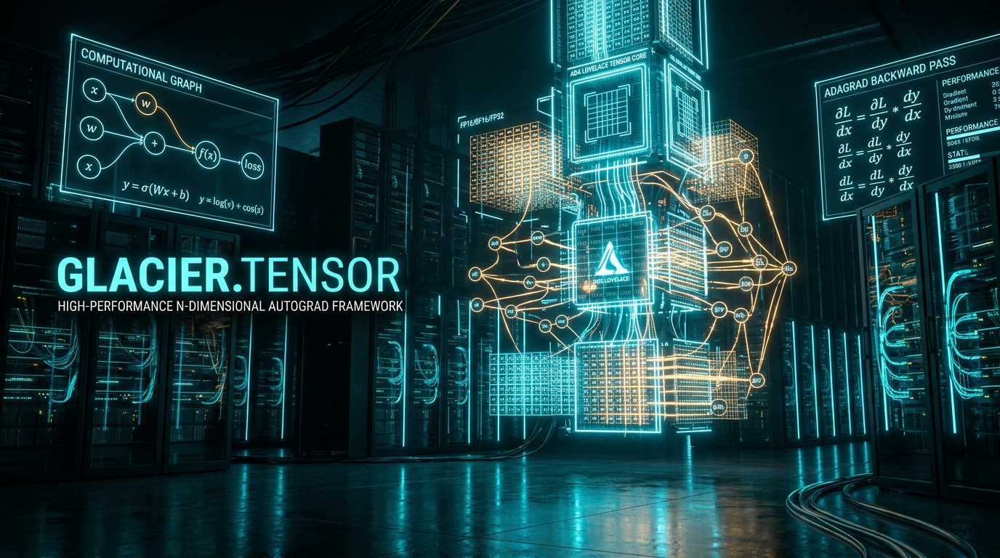

# Glacier.Tensor

[](LICENSE)
[](https://dotnet.microsoft.com/)
[](https://learn.microsoft.com/dotnet/core/deploying/native-aot/)
[](https://www.nuget.org/packages/Glacier.Tensor/)

`Glacier.Tensor` is an N-dimensional strided tensor, reverse-mode autograd, and neural-network kernel library written in pure C# for .NET 10.

It provides unmanaged 64-byte-aligned tensors with zero-copy slicing and transposition, an autograd tape with nested scope isolation, cache-blocked CPU SIMD GEMM, GPU matrix multiplication across CUDA, Direct3D 12, and Vulkan, plus built-in layers, losses, LoRA adapters, and optimizers with no Python or C++ runtime dependencies.

## Install

```bash
dotnet add package Glacier.Tensor
```

## Quick Start

```csharp
using Glacier.Tensor.Autograd;
using Glacier.Tensor.Core;
using Glacier.Tensor.Layers;
using Glacier.Tensor.Losses;
using Glacier.Tensor.Optimizers;

using var x = TensorFloatExtensions.RandomUniform([32, 8], -1f, 1f, seed: 1);
using var targets = Tensor<float>.Zeros(32, 3);
for (int i = 0; i < 32; i++) targets[i, i % 3] = 1.0f;

using var l1 = new Linear(inFeatures: 8, outFeatures: 16, seed: 42);
using var l2 = new Linear(inFeatures: 16, outFeatures: 3, seed: 43);
var parameters = new[] { l1.Weight, l1.Bias, l2.Weight, l2.Bias };
using var optimizer = new AdamW(parameters, lr: 0.05f);

for (int epoch = 0; epoch < 25; epoch++)
{
    optimizer.ZeroGrad();

    using var tape = new AutogradTape();
    foreach (var p in parameters) tape.Watch(p);

    using var h1 = l1.Forward(x);
    using var act = TensorOps.GELU(h1);
    using var logits = l2.Forward(act);
    var (_, lossTensor) = LossFunctions.CrossEntropy(logits, targets);
    using var _loss = lossTensor;

    tape.Backward(lossTensor);
    optimizer.Step();
}
```

## What You Can Do

| Capability | Description | Key Types |
| :--- | :--- | :--- |
| **Strided Tensors & Views** | Up to 8D unmanaged buffers (`Shape8`, `Strides8`) with reference-counted slices, reshapes, and transposes | `Tensor<T>`, `NativeMemoryBlock<T>`, `Shape8`, `Strides8`, `TensorOps` |
| **Reverse-Mode Autograd** | Scoped `[ThreadStatic]` tape stack supporting nested inner tapes and reusable scratch workspaces | `AutogradTape`, `TapeEntry`, `AutogradOp`, `AutogradScratchWorkspace` |
| **Layers, LoRA & Optimizers** | Prebuilt dense, normalization, and low-rank adapter layers with AdamW and SGD optimizers | `Linear`, `LoraLinear`, `LayerNorm`, `Sequential`, `AdamW`, `SGD` |
| **Losses & Fused Cross-Entropy** | Mean squared error, BCE, cross-entropy, categorical cross-entropy, Brier/ECE, and tiled LM-head cross-entropy | `LossFunctions`, `FusedCrossEntropyLoss` |
| **CPU & GPU Matrix Kernels** | AVX-512 / AVX2 / AdvSimd blocked GEMM plus CUDA, cuBLAS, Tensor Core WMMA, Direct3D 12, and Vulkan compute | `GemmKernels`, `GpuAccelerator`, `DeviceResidentTensor<T>`, `GpuTarget` |
| **Ecosystem Interop** | Zero-copy/direct conversion with `Glacier.Polaris` data frames and `Glacier.Compute` ring AllReduce | `PolarisExtensions`, `GlacierDistributedTensorExtensions` |

## Platform & Compatibility

- Targets `.NET 10` (`<IsAotCompatible>true</IsAotCompatible>`, `<TreatWarningsAsErrors>true</TreatWarningsAsErrors>`).
- CPU kernels execute on x64 (`AVX-512`, `AVX2`, scalar fallback) and ARM64 (`AdvSimd`).
- GPU GEMM supports NVIDIA CUDA (`nvcuda.dll` / `libcuda.so.1`), NVIDIA Tensor Cores (`sm_75+`), Direct3D 12 Compute (Windows), and Vulkan 1.3 (`GpuTarget` routes `Auto`, `Cpu`, `Nvidia`, `NvidiaTensorCore`, `Direct3D12`, `Vulkan`, `Amd`, or `DualGpu`).

## Benchmarks

Measured with `dotnet run --project benchmarks/Glacier.Tensor.Benchmarks/Glacier.Tensor.Benchmarks.csproj -c Release` on an AMD Ryzen AI 9 HX 370 (`.NET 10.0.15`, Windows 11) with NVIDIA GeForce RTX 4060 Laptop GPU:

| Benchmark | Backend | Latency | Throughput |
| :--- | :--- | ---: | ---: |
| **GEMM `1024 x 1024` FP32** | CPU (`GemmKernels.MatMul`) | `4.77 ms` | **449.80 GFLOPS** |
| **GEMM `2048 x 2048` FP32** | CPU (`GemmKernels.MatMul`) | `33.10 ms` | **519.07 GFLOPS** |
| **GEMM `2048 x 2048` FP32** | RTX 4060 Resident (`DeviceResidentTensor`) | `3.387 ms` | **5.07 TFLOPS** |
| **GEMM `2048 x 2048` FP32** | D3D12 Resident (`D3D12GemmKernel`) | `3.917 ms` | **4.39 TFLOPS** |
| **Autograd MLP `64x128->256->16`** | CPU (`Linear`+`LayerNorm`+`GELU`+`CrossEntropy`+`AdamW`) | `0.599 ms/step` | — |

See [docs/benchmarks.md](docs/benchmarks.md) for full Vulkan, copied-vs-resident GPU, and LoRA layer measurements.

## Documentation

- [User Manual](docs/manual.md) — tensors, views, autograd, layers, losses, GPU execution, Polaris interop, and diagnostics
- [Architecture](docs/architecture.md) — unmanaged reference counting, thread-static tape stack, SIMD GEMM tiling, and GPU dispatch
- [Benchmarks](docs/benchmarks.md) — complete hardware/OS/.NET spec and measured CPU/CUDA/D3D12/Vulkan results
- [Changelog](CHANGELOG.md) — release history

## License & Credits

Licensed under the [MIT License](LICENSE). Copyright (c) 2026 Ian Cowley.

Developed by Ian Cowley, Antigravity (Google DeepMind) and Claude.
